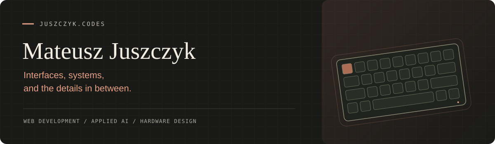

### Hey, I'm Mateusz.

**Junior Developer at [Algoteque](https://algoteque.com)** · Based in Poland

I build for the screen, the server, and sometimes the desk underneath them.
My work spans web interfaces, full-stack applications, applied AI, and custom mechanical keyboards.

I like understanding how the whole thing fits together: the interaction someone notices, the API behind it, and the small decisions that make it hold up in everyday use.

**[Explore my work → juszczyk.codes](https://juszczyk.codes)**

 

#### FROM INTERFACE TO INFRASTRUCTURE

**Frontend** · TypeScript, React / Next.js, Vue / Nuxt  
**Backend & cloud** · Cloudflare Workers, Hono, D1, Drizzle  
**Applied AI** · LLM integrations, agentic workflows, evaluation  
**Also in the toolbox** · WordPress, WooCommerce, CAD

 

#### A FEW THINGS FROM THE WORKBENCH

**[Web products & experiments ↗](https://juszczyk.codes/#work)**  
Commerce, operations tools, and applications built around the way people actually work. The stories behind them live on my portfolio.

**[Clover TKL ↗](https://github.com/MateuszJuszczyk/Clover-TKL)**  
An open-source mechanical keyboard with three mounting options and a triple-weight construction. A different kind of interface design.

**[Katana60 ↗](https://github.com/MateuszJuszczyk/Katana60) · [Shark60 ↗](https://github.com/MateuszJuszczyk/shark60)**  
Compact keyboard designs exploring materials, mounting, and the feel of a finished object.

 

#### CURRENTLY CURIOUS ABOUT

AI workflows I can inspect and trust. Interfaces that stay useful offline. Moving product logic to the edge. And why a tiny design detail can change how an entire product feels.

---

[Portfolio](https://juszczyk.codes) &nbsp; / &nbsp; [LinkedIn](https://www.linkedin.com/in/mateusz-juszczyk-381a78422/) &nbsp; / &nbsp; [Email](mailto:m.juszczyk@icloud.com)

Good software. Thoughtful hardware. Always something on the workbench.
